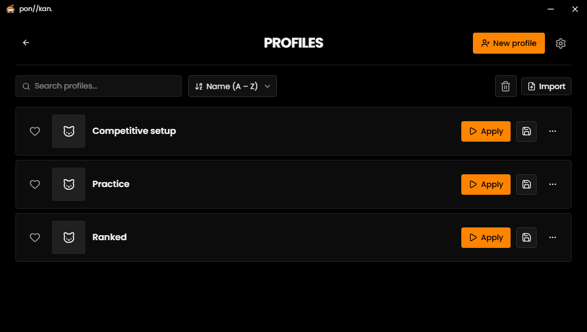
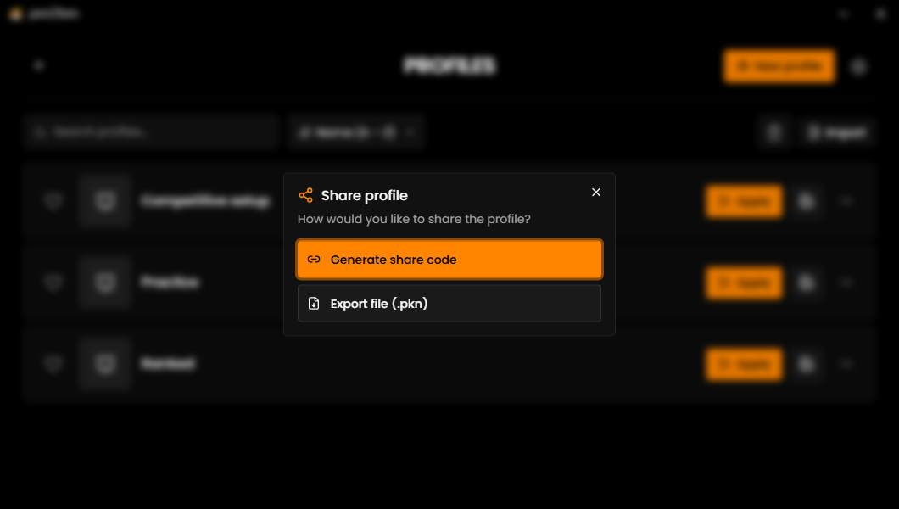

<p align="center">
  
</p>

<h1 align="center">pon//kan.</h1>

<p align="center">Save, restore and share your VALORANT settings.</p>

<p align="center">
  <a href="https://github.com/rfpupo/ponkan/releases/download/v0.3.0-beta/ponkan_0.3.0_x64-setup.exe"></a>
  <a href="https://github.com/rfpupo/ponkan/releases"></a>
  <a href="https://github.com/rfpupo/ponkan/issues/new"></a>
</p>

<p align="center"></p>

> **Release status:** Version 0.3.0 is being prepared for its first beta release. The installer will be available here once published. See [Limitations](#limitations) for the current development and testing status.

## About

Ponkan is a free, open-source desktop app for managing your VALORANT settings on Windows. If you like to experiment with different configurations or keep a separate setup for practice, you can save each one as a profile and return to it later.

Each profile has its own name and can be managed from a single library. You can also export a profile to a file or share supported settings with a friend through a short code.

Ponkan works outside the game. It focuses on settings management and does not include an in-game overlay or gameplay automation.

<p align="center"></p>
<p align="center"><sub>The profile library, shown with example profiles and no real account data.</sub></p>

## Features

 **Profile management**

- **Save and update:** Save your current local and Riot cloud settings as a named profile. If you make changes later, use the save icon to update it.
- **Apply:** Restore a profile while VALORANT is closed. Ponkan checks the Riot session and can back up your current configuration first.
- **Organize:** Search, sort, rename and favorite profiles. Give each profile its own image or keep the default cat avatar.
- **Compare:** For supported profiles, an indicator lets you know when the saved settings match your current local and cloud configuration.
- **Recycle bin:** Recover deleted profiles or remove them permanently. You can choose how long they stay in the recycle bin.

 **Import and sharing**

- **File export (.pkn):** Keep a copy of a profile or send it to someone as a local file. You can include an author, description and avatar.
- **File import:** Preview a profile, choose its name and add it to your library. Importing a profile leaves your current game settings untouched until you apply it.
- **Short share codes:** Share supported settings without sending a file. Codes are optional and use is.gd, so generating or importing one requires an internet connection.

 **Application preferences**

- Choose between dark, light and system appearance.
- Use the app in English, Brazilian Portuguese or Spanish.
- Configure confirmations before applying or overwriting profiles.
- Enable automatic backups before switching profiles.
- Choose whether Ponkan starts with Windows, starts minimized or closes to the system tray.
- Set the recycle bin retention period.

## Screenshots

A closer look at the settings page and the sharing options. The screenshots were captured using the app's interface with example data.

<table>
  <tr>
    <td align="center" width="50%"><br><strong>Settings</strong></td>
    <td align="center" width="50%"><br><strong>Sharing</strong></td>
  </tr>
</table>

<p align="center"></p>

## Download & installation

### Requirements

| Requirement | Details |
| --- | --- |
| Operating system | Windows 11, 64-bit |
| Runtime | Microsoft Edge WebView2 (the installer can download its bootstrapper) |
| Game services | VALORANT installed, with the Riot Client signed in when saving or applying profiles |
| Internet | Needed to communicate with Riot and use short share codes |

### Install

1. Once the beta is published, open [Releases](https://github.com/rfpupo/ponkan/releases) and download `ponkan_0.3.0_x64-setup.exe`.
2. If you want to verify your download, compare the result of the following PowerShell command with the value in `SHA256SUMS.txt`:

   ```powershell
   Get-FileHash .\ponkan_0.3.0_x64-setup.exe -Algorithm SHA256
   ```

3. Run the installer and follow the setup instructions. Ponkan installs for your current Windows user.
4. Open Ponkan from the Start menu.

The beta installer is not digitally signed, so you may see a Windows SmartScreen warning. The checksum lets you check whether your download matches the published installer, although it cannot establish that a program is safe. Always download from the project's official releases and take unexpected security warnings seriously.

If you're coming from an older version, keep a backup of your existing profiles. The installer can block an upgrade when it detects legacy data because automatic migration is not yet supported. Leave that data in place.

## Getting started

### Save your first profile

1. Sign in to the Riot Client and set up VALORANT the way you normally play.
2. Close VALORANT.
3. Open Ponkan, go to **Profiles** and select **New profile**.
4. Give the profile a name and save it.

### Restore or update a profile

1. Make sure VALORANT is closed and you're signed in to the intended Riot account.
2. Find the profile you want to use and select **Apply**.
3. Once the operation finishes, you can open the game again.
4. If you want to save your latest changes to an existing profile instead, select its save icon.

You can turn on automatic backups in Settings to keep a copy of your current configuration before switching. Keeping a separate backup is also a good idea while testing a beta.

### Import or share a profile

Open a profile's options menu and choose **Share profile**. From there, **Generate share code** lets you share supported portable settings, while **Export file (.pkn)** creates a local file. To receive a profile, use **Import** in your profile library.

Both options serve different purposes. Codes are convenient for sharing, but they are not private links. A full file may include account identifiers and device-specific settings, so check what you're sending and import profiles from people you trust.

## How it works

Ponkan is built with React and TypeScript for the interface and Tauri for the desktop application. Its Rust backend handles local files and communicates with the Riot Client and Riot's player preference service.

| Operation | What happens |
| --- | --- |
| Save | Reads cloud preferences from the current authenticated Riot session and stores them alongside local configuration data. |
| Apply | Checks that the game is closed, reconciles pending recovery records, validates the session and prepares the local and cloud changes. |
| Export | Creates a local .pkn package with profile metadata and integrity information. |
| Import | Checks the selected package or decoded portable settings before adding a profile to the library. |
| Short code | Uses is.gd to share and retrieve compressed portable settings. |

The backend includes transaction and recovery logic to help handle interrupted operations. Testing those recovery paths with live game data is still part of the beta work.

The integration relies on undocumented Riot interfaces. Updates to VALORANT or the Riot Client may require changes to Ponkan as well.

<p align="center"></p>

## Privacy & security

Your profiles, preferences, avatars, recycle bin entries and recovery records are stored on your computer. Ponkan has no separate account system, advertising or developer-hosted analytics service.

Saving and applying profiles uses your existing Riot Client session. Authorization tokens are handled in memory by the native backend. The local HTTPS connection accepts the Riot Client's local certificate, while connections to Riot's cloud service use TLS.

If you choose to generate or import a short code, Ponkan communicates with is.gd. That service can receive the compressed settings and network metadata. The codes are not encrypted or confidential. Exporting a local file does not require sending it to that service.

You can find the details in [Privacy](PRIVACY.md). The [Security](SECURITY.md) page explains how to report security issues without sharing private information.

## Limitations

Version 0.3.0 is the first planned beta for Windows 11 x64. The Windows CI build has passed, and clean installation and automated tests have been checked. Full native testing, recovery with live game data and migration from older versions remain incomplete.

Ponkan is an independent project and has not been approved by Riot. Its settings integration uses undocumented services, so compatibility and protection against account restrictions cannot be guaranteed. Riot review and applicable distribution approval remain pending.

A few other things to keep in mind:

- The installer is currently unsigned, and updates are installed manually.
- Profiles may behave differently across accounts, computers or game versions. Portable profiles may contain only a subset of the original settings.
- The [third-party inventory](third-party-notices/INDEX.json) records two remaining questions about the provenance of dependency license notices.

## Build from source

The tested development environment uses Node.js 24.22.3, Rust 1.100.0, the MSVC C++ build tools and WebView2.

```bash
npm ci
node scripts/verify-public-source.mjs
npm run desktop:build -- --locked
```

The Windows NSIS installer is generated under `src-tauri/target/release/bundle/nsis/`.

To run the development version:

```bash
npm run desktop:dev
```

Development builds have their own application identity and storage, separate from the release version. Use example data when developing or reproducing issues. The committed lockfiles help keep dependency versions consistent between builds.

| Directory | Purpose |
| --- | --- |
| `src/` | React interface, translations and profile interactions |
| `src-tauri/` | Rust backend, native commands and Windows installer |
| `third-party-notices/` | Dependency notices and license inventory |
| `assets/` | README images and project branding |

## FAQ

**Do I need a separate Ponkan account?**

No. Just use your existing Riot Client session when saving or applying profiles.

**Can I switch profiles while VALORANT is running?**

Close the game before applying a profile. You can reopen it when Ponkan finishes.

**Are share codes the same as a full backup?**

They serve different purposes. Codes are for sharing supported portable settings, while a full .pkn export is a local package that may include more information, including private settings.

**Is Ponkan approved by Riot?**

Not yet. The app uses undocumented services and cannot guarantee that using it will not result in account restrictions.

**Does it update automatically?**

Updates are manual. New versions will be available through GitHub Releases.

**Why does the installer warn about an older installation?**

Automatic migration from legacy profile storage is not supported yet. Keep your old data and backups until a migration path is available.

## Contributing & support

If something doesn't work as expected, open an issue through [GitHub Issues](https://github.com/rfpupo/ponkan/issues). It helps to include your Ponkan and Windows versions, what you expected to happen and how to reproduce the problem.

Please use example data in reports. Keep credentials, account identifiers, real .pkn files, cloud snapshots and private screenshots out of public issues.

Contributions are welcome. Keep changes focused, follow the existing interface design and use the separate development configuration. Contributions are licensed under MIT.

## Credits & license

Ponkan is distributed under the [MIT License](LICENSE). The backend integration is adapted from [ValoUtils v1.0.17](https://github.com/windowsedd/ValoUtils). The project uses React, Tauri, Radix UI, shadcn/ui, Lucide, Poppins and other open-source components. Development is directed by the project maintainer with AI assistance.

The [third-party acknowledgements](LICENSE-THIRD-PARTY.txt) and [notice inventory](third-party-notices/INDEX.json) contain the relevant credits and licensing information.

Ponkan isn't endorsed by Riot Games and doesn't reflect the views or opinions of Riot Games or anyone officially involved in producing or managing Riot Games properties. Riot Games, and all associated properties are trademarks or registered trademarks of Riot Games, Inc.
