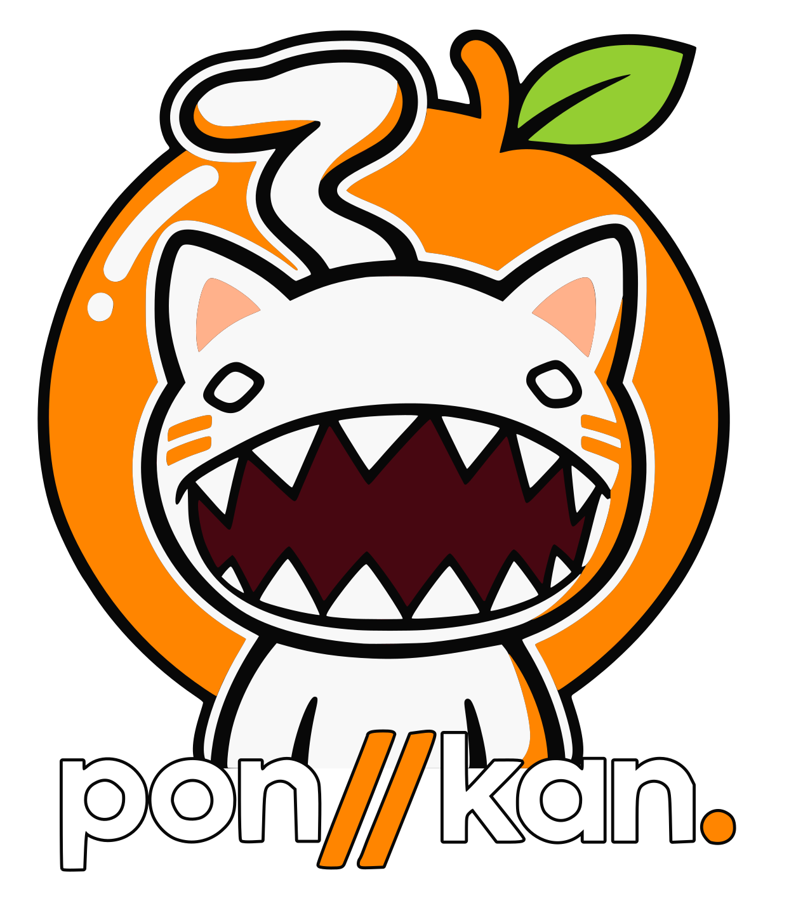
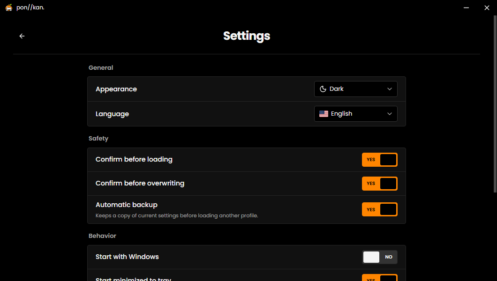

<p align="center">
  
</p>

<h1 align="center">pon//kan.</h1>

<p align="center">Save, restore and share your VALORANT settings.</p>

<p align="center">
  <a href="https://github.com/rfpupo/ponkan/releases/download/v0.3.0-beta/ponkan_0.3.0_x64-setup.exe"></a>
  <a href="https://github.com/rfpupo/ponkan/releases"></a>
  <a href="https://github.com/rfpupo/ponkan/issues/new"></a>
</p>

<p align="center"></p>

> **Release status:** The 0.3.0 beta candidate has not been published. Download links will work when the release is available. See [Limitations](#limitations) before using the application.

## About

Ponkan is a free, independent, open-source Windows desktop application for managing VALORANT settings profiles. It is designed for players who want to keep several setups, switch between them without manually reconstructing their settings, or share a portable profile with someone else.

Instead of repeatedly changing settings in the game, save a named profile and restore it when needed. Keep separate competitive and practice setups, retain a backup before experimenting, or organize settings from different configurations in one local library.

Ponkan is not a VALORANT client, an in-game overlay or a gameplay automation tool. Its scope is settings management outside the game.

<p align="center"></p>
<p align="center"><sub>Application interface captured with synthetic example profiles. No live Riot account data is shown.</sub></p>

## Features

 **Profile management**

- **Save and update:** Create named snapshots of your current local and Riot cloud preferences. Update an existing profile using its save action.
- **Apply:** Restore a stored profile with VALORANT closed. The backend checks the current session and can optionally create a backup before applying changes.
- **Organize:** Search, sort, rename and favorite profiles. Assign a custom profile image or use the default cat avatar.
- **Compare:** Where supported, a matching indicator shows that the saved local and cloud settings correspond to the current settings.
- **Recycle bin:** Restore accidentally deleted profiles or permanently remove them. Retention can be configured in Settings.

 **Import and sharing**

- **File export (.pkn):** Save a profile to a local file for backup or transfer. Exports support optional author, description and avatar metadata.
- **File import:** Preview the profile, check its name and import it into the library. Imports do not automatically apply the profile to the game.
- **Short share codes:** Generate a compact code for supported portable settings, or import a code someone sends you. This optional feature requires an internet connection and uses is.gd.

 **Application preferences**

- Dark, light and system appearance.
- English, Portuguese (Brazil) and Spanish interface languages.
- Confirmation before applying or overwriting profiles.
- Optional automatic backup before applying a profile.
- Windows startup, minimized startup, close-to-tray behavior and recycle bin retention.

## Screenshots

The following captures use the application's existing interface with synthetic data, not a redesigned mockup or proof of live Riot integration.

<table>
  <tr>
    <td align="center" width="50%"><br><strong>Settings</strong></td>
    <td align="center" width="50%"><br><strong>Sharing</strong></td>
  </tr>
</table>

<p align="center"></p>

## Download & installation

### Requirements

| Requirement | Details |
| --- | --- |
| Operating system | Windows 11, 64-bit |
| Runtime | Microsoft Edge WebView2 (the installer can download its bootstrapper) |
| Game services | VALORANT installed and Riot Client signed in for settings operations |
| Internet | Required for communication with Riot and optional short share codes |

### Install

1. Open [Releases](https://github.com/rfpupo/ponkan/releases) and download `ponkan_0.3.0_x64-setup.exe` once the beta is published.
2. Optionally download `SHA256SUMS.txt` and compare the installer checksum using PowerShell:

   ```powershell
   Get-FileHash .\ponkan_0.3.0_x64-setup.exe -Algorithm SHA256
   ```

3. Run the installer and follow the instructions. It installs for the current Windows user.
4. Open Ponkan from the Start menu.

**Important:** The installer is unsigned, so Windows SmartScreen may warn about it. A matching checksum confirms the downloaded file matches the published file; it is not a guarantee of safety. Do not bypass a security warning for an unexpected or modified installer.

If an older version or legacy data is detected, the installer may block installation. Back up the old profiles and preserve their data; do not delete it to bypass the guard. Automatic migration is not supported in this candidate.

## Getting started

### Save your first profile

1. Sign in to the Riot Client and configure VALORANT as desired.
2. Close VALORANT before managing your settings.
3. Open Ponkan, select **Profiles**, then **New profile**.
4. Enter a name that makes the configuration easy to recognize and save it.

### Restore or update a profile

1. Keep VALORANT closed and the intended Riot account signed in.
2. Locate the saved profile and select **Apply** to restore it.
3. Wait for the operation to finish before opening the game.
4. To overwrite a profile with your current settings, use its save icon instead of creating a new entry.

Automatic backup can preserve a copy of the current configuration before applying another one. It is not a substitute for keeping independent backups, especially during the beta.

### Import or share a profile

Use the profile's options menu to open **Share profile**. Select **Generate share code** for supported portable settings, or **Export file (.pkn)** to save a local file. The **Import** action in the profile library supports importing a file or code.

A share code is not a private link, and a full profile file can contain account identifiers and device-specific settings. Review what you are sharing and only import profiles from sources you trust.

## How it works

Ponkan uses a React and TypeScript interface inside a Tauri desktop shell. The native Rust backend performs the file operations and communicates with the local Riot Client and Riot's player preference service.

| Operation | What happens |
| --- | --- |
| Save | Read the authenticated Riot session and cloud preferences, then store them with local configuration data. |
| Apply | Check that VALORANT is closed, reconcile pending recovery records, validate the session, and prepare local and cloud changes. |
| Export | Write a local .pkn package with metadata and integrity information. |
| Import | Validate the selected package or decoded portable settings and add a profile to the library. |
| Short code | Send portable compressed settings through is.gd and retrieve them when importing a code. |

The application includes transaction and recovery logic intended to reduce the risk of incomplete changes, but recovery behavior has not been fully validated in a real game environment.

The Riot preferences integration uses undocumented interfaces, not an approved public API. Changes to the Riot Client or VALORANT can affect compatibility.

<p align="center"></p>

## Privacy & security

Ponkan does not operate a developer-hosted account system, analytics service or advertising backend. Profiles, local preferences, avatars, recycle bin entries and recovery records are stored on the computer.

The native backend reads the local Riot Client session information and uses authorization tokens in memory to communicate with Riot's preference service. The local HTTPS connection accepts the local Riot certificate; cloud communication uses TLS.

Short share codes are optional and use an external service, is.gd. The service can receive the portable profile payload and network metadata. Codes are not encrypted or confidential. Local file export does not require uploading the file.

For a detailed account of data handling, see [Privacy](PRIVACY.md). For responsible vulnerability reporting and handling sensitive diagnostic information, see [Security](SECURITY.md).

## Limitations

- This is an experimental Windows 11 x64 beta candidate, not a stable release.
- The repository's Windows CI build has completed successfully. Clean installation and automated tests were checked, but full native end-to-end testing, live recovery and legacy migration are not complete.
- Riot review and applicable distribution approval remain pending. Compatibility and protection from account restrictions are not guaranteed.
- The installer is unsigned. There is no automatic updater.
- Cross-account, cross-device and cross-version restoration may behave differently; portable settings do not necessarily include every original local or cloud field.
- Two dependency license-notice provenance caveats remain documented in the [third-party inventory](third-party-notices/INDEX.json).

## Build from source

The tested development environment uses Node.js 24.22.3, Rust 1.100.0, the MSVC C++ build tools and WebView2.

```bash
npm ci
node scripts/verify-public-source.mjs
npm run desktop:build -- --locked
```

The Windows NSIS installer is generated under `src-tauri/target/release/bundle/nsis/`.

For local development:

```bash
npm run desktop:dev
```

The development configuration uses a separate application identity and storage. Use synthetic data while developing or reproducing problems. The dependency lockfiles are committed to make builds consistent.

| Directory | Purpose |
| --- | --- |
| `src/` | React interface, translations and profile interactions |
| `src-tauri/` | Rust backend, native commands and Windows installer |
| `third-party-notices/` | Dependency notices and license inventory |
| `assets/` | README images and project branding |

## FAQ

**Do I need a separate Ponkan account?**

No. The application uses the signed-in Riot Client session for settings operations.

**Can I switch profiles while VALORANT is running?**

No. Applying a profile requires the game to be closed.

**Are share codes the same as a full backup?**

No. Codes contain supported portable settings; a full .pkn export is a local package and may contain additional sensitive data.

**Does Ponkan guarantee that I will not be restricted by Riot?**

No. The integration uses undocumented services, and the product has not been approved by Riot.

**Does it update automatically?**

No. New versions will be made available through GitHub Releases.

**Why does the installer warn about an older installation?**

The beta does not automatically migrate legacy profile storage. Preserve your previous data instead of bypassing the guard.

## Contributing & support

Report bugs through [GitHub Issues](https://github.com/rfpupo/ponkan/issues). Include the Ponkan version, Windows version, expected behavior and steps to reproduce the issue using synthetic data. Do not attach credentials, account IDs, real .pkn files, cloud snapshots or private screenshots.

Keep contributions focused, preserve the existing interface and use the isolated development configuration. Contributions are licensed under MIT.

## Credits & license

Ponkan is distributed under the [MIT License](LICENSE). The backend integration is adapted from [ValoUtils v1.0.17](https://github.com/windowsedd/ValoUtils). The interface uses React, Tauri, Radix UI, shadcn/ui, Lucide and Poppins, among other components. Development is directed by the project maintainer with AI assistance.

See [third-party acknowledgements](LICENSE-THIRD-PARTY.txt) and the [notice inventory](third-party-notices/INDEX.json) for attribution and dependency licensing.

Ponkan isn't endorsed by Riot Games and doesn't reflect the views or opinions of Riot Games or anyone officially involved in producing or managing Riot Games properties. Riot Games, and all associated properties are trademarks or registered trademarks of Riot Games, Inc.
